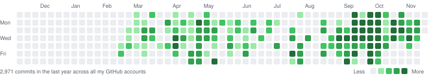

# Winnie Cheng

Product manager who builds. Since Mar 2026: **2,828 commits** and **565 merged PRs** across 4 private AI projects, built with Claude Code. The repos are private, so these are the stats.

## Faber

AI-adaptive courses for adults with apraxia, who can't use typical online courses because they can't reliably type.

- **Impact:** in beta with 8 families; 5 adults engaged for 30+ minutes vs. ~5 minutes with online courses
- 1,343 commits, 262 merged PRs (Sep–Nov 2026)
- 591 product and design decisions logged in specs, with rationale
- 31 eval reports gating AI prompt changes
- [Live site](https://vhelper-staging.vercel.app/about)

## SpeechBridge

Turns speech-therapy session transcripts into step-by-step prompting guides, so untrained aides can run speech practice between sessions.

- **Impact:** helped my previously nonverbal brother use 1–2 words spontaneously; used by 2 autistic adults
- 1,157 commits, 216 merged PRs (May–Nov 2026)
- 195 product and design decisions logged in specs, with rationale
- Bake-off harness comparing a local LLM against Claude

## vHelper

Claude Code jobs that manage scheduling, billing, invoice checks and budget tracking for a family's state-funded services across 8 vendors.

- **Impact:** caught 10 incorrect invoices and avoided 10+ weeks of payment delays
- 311 commits, 87 merged PRs (Mar–Jun 2026)

## BillCheck

AI skills that compare insurance claims against bills.

- **Impact:** saved $9–15K in billing errors
- 17 commits (Apr–Jul 2026)
