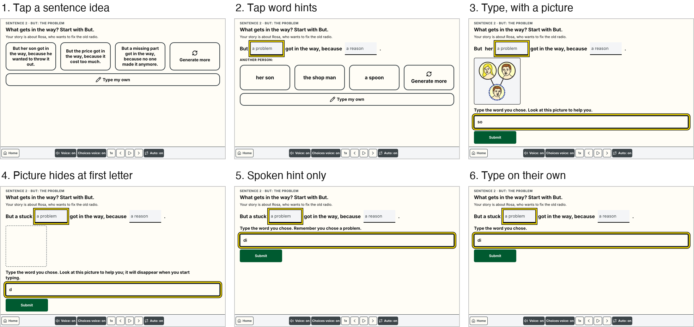

# Winnie Cheng

Product manager and ex–frontend engineer who builds. Since Feb 2026: **2,881 commits** and **572 merged PRs** across my private AI projects, built with Claude Code.

## Motor accessibility projects

Apps for people with motor challenges, which are common in autism: one large U.S. study found [~87% of autistic children at risk for motor impairment](https://pmc.ncbi.nlm.nih.gov/articles/7297441). These challenges make it hard to speak clearly, type fast, or even point; a person may mean to tap one thing and hit another. One cause is apraxia, where the brain struggles to plan movements: the person knows what they want to say or tap but can't reliably make their mouth or hands do it. Several of these apps use choiceboards: a few large choices in randomized positions, so the person can answer reliably by tapping.

### Faber

AI-driven courses where adults with apraxia learn to write their own songs and stories, one line at a time. Lessons are personalized to each learner's interests, and help fades step by step until they type on their own:

- **Impact:** in beta with 6 families; 5 of 6 adults stayed engaged 30+ minutes vs. ~5 minutes on online courses
- ~1,415 commits, ~273 merged PRs (May–Nov 2026); 591 spec decisions logged; 31 eval reports gating prompt changes
- [Learn more & demo](https://vhelper-staging.vercel.app/about)

### SpeechBridge

Turns speech-therapy transcripts into step-by-step guides that untrained aides follow between sessions. Guides include speech exercises and conversation starters built from photos of the person's day, so they practice talking about it out loud.

- **Impact:** helped my previously nonverbal brother use 1–2 words spontaneously; used by 2 autistic adults
- ~924 commits, ~185 merged PRs (May–Nov 2026); 195 spec decisions logged; local-LLM vs. Claude bake-off harness

### DailyLivingGuides

Short choiceboard lessons for daily-living skills like safety and cleaning up after lunch. Early questions use obviously wrong answers to train intentional tapping: "A big spill gets a ___ towel first, so it doesn't soak into the table." → hamster · **paper** · tickle · xylophone

- **Impact:** my brother opens the car door safely much more often; checking for cars before crossing is improving more slowly
- ~163 commits, ~21 merged PRs (May–Oct 2026)

### InstructionsBridge (abandoned)

The first vHelper prototype, a React Native app. It turned a text description of a task into draft step-by-step instructions that caregivers refined by chatting with AI, and turned menu screenshots into multi-step ordering choiceboards (entrée → protein → toppings).

- **Impact:** learning project; showed that step-by-step help works better as one-off AI drafts that an aide edits
- ~311 commits, ~87 merged PRs (Mar–Jun 2026)

### ChoiceBoard (paused)

A standalone choiceboard app for everyday communication. Paused until it can build choices on the fly from what the person types or the aide says, using the family's lists of favorite foods, places and activities; that's now planned inside Faber.

- ~35 commits, ~5 merged PRs (Feb–Jun 2026)

## Business automation workflows

### vHelper

Scheduled Claude Code jobs that run the admin for my autistic brother's state-funded services across 8 vendors: invoicing, invoice checks, budget tracking, room booking, and a nightly brief of the day program's email and texts.

- **Impact:** caught 10 incorrect invoices and avoided 10+ weeks of payment delays
- 3 cloud routines and 1 nightly local job; ~16 commits, ~1 merged PR (Apr–Sep 2026)

## Personal automation workflows

### BillCheck

Six Claude Code skills that check medical bills against UMR insurance claims. They read bills from photos and PDFs, flag charges above what the claim says we owe, and track reimbursement on claims we file ourselves.

- **Impact:** saved $9–15K in billing errors
- **Engineering:** Data lives in Postgres on Supabase: claim lines reload on each import, a tracking table keyed on claim number persists across reimports and links claims to bills (many-to-one for bundled bills), and self-filed claims follow a CHECK-enforced status lifecycle.
- ~17 commits (Apr–Jul 2026)
